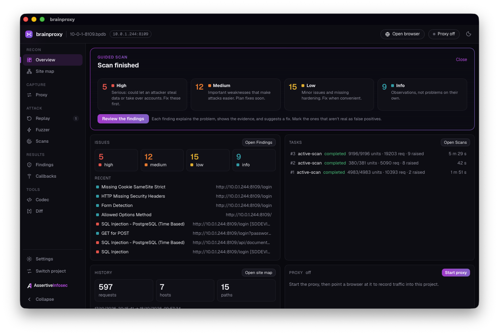
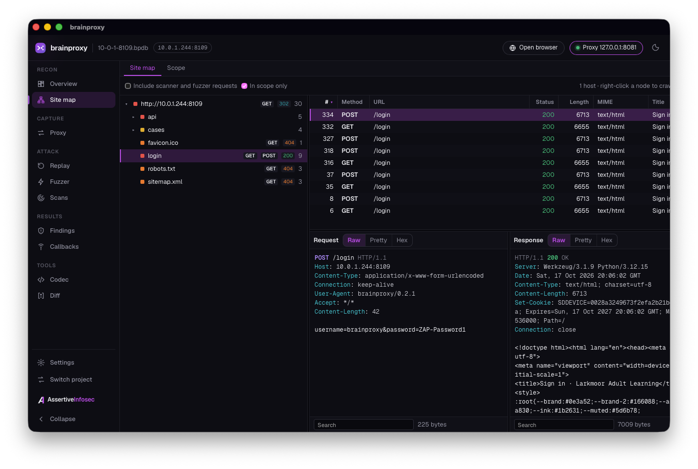
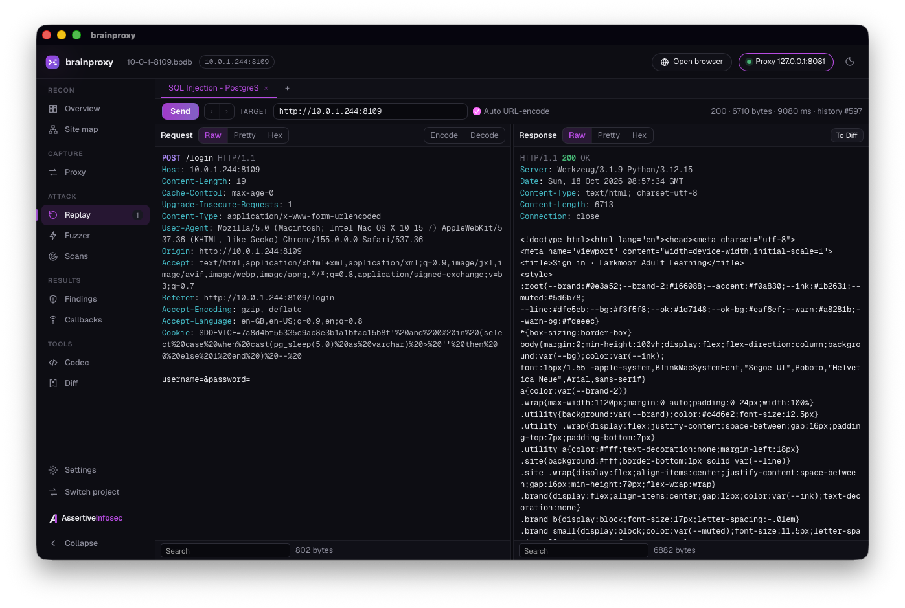
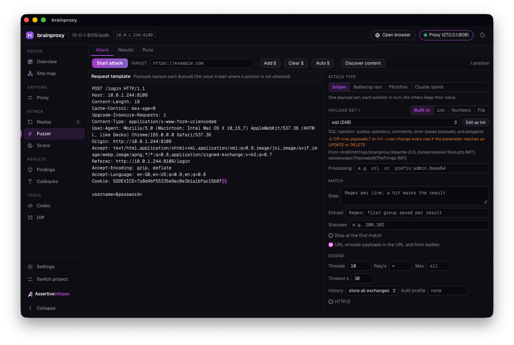

# brainproxy

A fast, AI-first web security testing toolkit written in Rust. Some UI elements are modelled
on other apps, and the scan rules are ported from OWASP ZAP (Apache 2.0, see NOTICE). Its main
operator is an AI pentesting platform: **Braintruder** drives it through a Kali runner. Every feature is a
non-interactive CLI command with structured JSON output, and a desktop app for macOS,
Linux, and Windows runs on the same engine.



Only use it against systems you are authorized to test.

## Highlights

- **Guided scan.** Pick the sites and a depth (Quick, Standard, Thorough) and the Overview
  crawls, attacks, and shows the results. Open it again any time from the Overview or
  Scans › New scan.
- **Targeted scans.** Search the ZAP scan rules and the Nuclei and brainproxy checks by
  name, CVE, or tag (Scans › New scan › Targeted), pick a few, and run only those.
- **Checks for new CVEs between releases.** brainproxy's own checks come from a signed
  feed (Ed25519, verified before anything is installed) and update once a day, so a new
  CVE check doesn't wait for a new app version. One-click **CVE quick checks** run one of
  them on your sites, such as the Brotli decoder bug CVE-2026-111497. PHP2Shell
  (CVE-2026-109618, CVE-2026-109619) has its own built-in check.
- **Passive checks.** Feed and local checks with `scope: passive` look at the traffic you
  record and send nothing, next to the built-in passive rules.
- **Reports people can read.** Findings › Report… saves an HTML report with a plain-words
  summary, what to fix first, and the technical evidence folded away. It prints cleanly to
  PDF.
- **See what a retest fixed.** Compare findings with a scan: new in it, still found, or
  not found again (likely fixed), counting only what that scan actually covered.
- **Scan rules from OWASP ZAP, plus about 10,000 Nuclei templates**, all run inside a
  write-once engagement scope that every request is checked against.

## Manual

[docs/MANUAL.md](docs/MANUAL.md): install, concepts, a first engagement step by step, every
tool in the desktop app, the command line, agents, and troubleshooting.

## Desktop app

Tagged releases also attach the desktop GUI with the CLI bundled inside:
`brainproxy-gui-<version>-macos-arm64.dmg`, `brainproxy-gui-<version>-linux-x86_64.deb` / `.AppImage`, and
`brainproxy-gui-<version>-windows-x86_64.msi` / `-setup.exe` (e.g. `brainproxy-gui-0.3.9-macos-arm64.dmg`;
releases up to 0.3.8 have no version in the names). The apps aren't signed yet: on macOS open
the app once, then System Settings → Privacy & Security → Open Anyway; on Windows choose More info → Run anyway. The
command line alone for Windows is `brainproxy-<version>-windows-x86_64.exe`; the bundled one is
`C:\Program Files\brainproxy\brainproxy.exe` (`.msi`) or `%LOCALAPPDATA%\brainproxy\brainproxy.exe`
(`-setup.exe`). See
[docs/GUI.md](docs/GUI.md).

| Site map | Replay | Fuzzer |
| --- | --- | --- |
| [](docs/screenshots/sitemap.png) | [](docs/screenshots/replay.png) | [](docs/screenshots/fuzzer.png) |

## Install on Kali (CLI only)

brainproxy builds into one static binary with no runtime dependencies, for **arm64**
(Braintruder's Kali target) and x86_64. Tagged releases attach both
(`brainproxy-<version>-linux-arm64`, `brainproxy-<version>-linux-x86_64`), each with a `.sha256`
file, plus one `SHA256SUMS` covering every download in the release (up to 0.3.8 the names have
no `<version>-`, and there is no `SHA256SUMS`):

```sh
v=$(curl -fsSLo /dev/null -w '%{url_effective}' https://github.com/r4nd0mth1ngs/brainproxy/releases/latest | sed 's|.*/tag/v||')
f=brainproxy-$v-linux-arm64
curl -fLO https://github.com/r4nd0mth1ngs/brainproxy/releases/download/v$v/$f
curl -fLO https://github.com/r4nd0mth1ngs/brainproxy/releases/download/v$v/$f.sha256
sha256sum -c $f.sha256
sudo install -m755 $f /usr/local/bin/brainproxy
```

Build an arm64 binary from any Linux machine:

```sh
rustup target add aarch64-unknown-linux-musl
pip install ziglang && cargo install cargo-zigbuild
make static-arm64              # -> target/aarch64-unknown-linux-musl/release/brainproxy
```

Or build x86_64:

```sh
# Build once (on Kali or any Linux box with Rust installed)
sudo apt install -y musl-tools
rustup target add x86_64-unknown-linux-musl
make static                    # -> target/x86_64-unknown-linux-musl/release/brainproxy
sudo make install              # -> /usr/local/bin/brainproxy
```

Or copy the `brainproxy-<version>-linux-x86_64` artifact from CI (or a tagged release) onto the runner.

## Engagement scope (required)

brainproxy sends nothing until a scope exists, and every outbound request (send, race,
fuzz, crawl, proxy upstream, scans) must match it. The check happens at connect time,
after DNS resolution, and the connection goes to the checked address. Link-local
addresses such as cloud metadata (169.254.169.254) are refused unless listed by address.

```sh
brainproxy engagement start --target app.example.com --target '*.api.example.com' \
    --target 10.0.0.0/24 --exclude 10.0.0.1 --name "ACME pentest"
brainproxy engagement show
brainproxy engagement check 10.0.0.7:8443
```

`engagement start` is write-once: the scope can't be changed or removed afterwards.

**Runner setup (Braintruder / Kali).** The engagement scope protects a project, but an
agent could start a new project. For a hard lock, the runner writes the scope to
`/etc/brainproxy/scope.json` (root-owned, not writable by the agent) before handing over:

```json
{"name": "ACME pentest", "include": ["app.example.com", "*.api.example.com", "10.0.0.0/24"], "exclude": ["10.0.0.1"]}
```

While that file exists it is always enforced (on top of any engagement scope), and no flag
or environment variable can override it; an unreadable or invalid file blocks all traffic.
Run the agent as a non-root user. On Windows the file is
`C:\ProgramData\brainproxy\scope.json`; create it as an administrator and run the agent as
a standard user, who can read it but not change it. For defence in depth, also restrict the runner's egress
with a firewall, since other tools on the box (curl, sqlmap, ...) aren't bound by brainproxy.

## Usage

```sh
export BRAINPROXY_PROJECT=/work/engagement.bpdb   # capture DB, created on first use

# Send requests (Repeater). Each one is recorded in the capture DB.
brainproxy send --url 'https://target.test/api?id=1' -X POST -H 'Content-Type: application/json' -d '{"a":1}'
brainproxy send request.http                      # raw request; target from the Host header
cat request.http | brainproxy send --target http://10.0.0.5:8080

# Query captures with read-only SQL
brainproxy schema                                 # columns, helper functions, example queries
brainproxy query "SELECT id, status, url, title FROM history WHERE status >= 500"
brainproxy query "SELECT id, url FROM history WHERE resp_body_text REGEXP '(?i)sql syntax|ORA-[0-9]{5}'"
brainproxy query "SELECT id, header(resp_headers, 'server') FROM history"
brainproxy query "SELECT rowid FROM history_fts WHERE history_fts MATCH 'password'"
brainproxy query "SELECT id FROM history WHERE host = ?1 AND path LIKE ?2" -p target.test -p '/api/%'

# New versions: check GitHub, save the verified binary (or --kind gui for the app installer)
brainproxy update check
brainproxy update download --dir ~/Downloads

# Intercepting proxy (runs in the background; captures go to the same DB)
brainproxy proxy start --listen 127.0.0.1:8080    # prints proxy URL, CA path, curl/env hints
brainproxy browser list                                         # installed Chrome/Chromium/Edge/Brave/Firefox
brainproxy browser open --browser chrome https://app.example.com  # through the proxy, own profile, CA trusted
curl --noproxy '' -x http://127.0.0.1:8080 --cacert ~/.local/share/brainproxy/ca/ca.pem https://target.test/
# Clients that offer h2 on intercepted TLS get HTTP/2 (--no-http2 turns it off); each
# stream is recorded as "GET /x HTTP/2" and goes upstream over HTTP/2 when the origin
# negotiates it, else as HTTP/1.1. Rules, intercept, auth, and passive scans apply as usual.
sudo brainproxy ca install-system                 # or trust the CA system-wide (Kali/Debian; Windows: current user, no sudo)
brainproxy scope set --include '(^|\.)target\.test$' # only intercept/record these hosts
brainproxy rules add --location request-header --replace 'X-Forwarded-For: 127.0.0.1'
brainproxy rules add --location response-body --match 'disabled' --replace ''
brainproxy proxy status
brainproxy proxy stop

# Intercept without a human in the loop: held messages wait in a queue
brainproxy intercept enable --method 'POST|PUT' --host 'target\.test' --timeout 120
brainproxy intercept list --wait 30               # block until something is held
brainproxy intercept show 4 --raw > msg.http      # edit it...
brainproxy intercept forward 4 --file msg.http    # ...and release it (or: intercept drop 4)
brainproxy intercept disable

# Fuzzing (Intruder): mark positions with §value§
brainproxy fuzz run --url 'https://target.test/api/user?id=§1§' -p range:1-500 --grep 'api_key'
brainproxy fuzz run req.http --mode cluster-bomb -p file:users.txt -p file:pass.txt \
    --grep '"ok": ?true' --extract '"token": "([^"]+)"' --stop-on-match --store matches
brainproxy fuzz run req.http -p file:big.txt --rate 50 --background    # returns a run id
brainproxy fuzz status 3          # baseline, outliers, matches, errors
brainproxy fuzz results 3 --matched
brainproxy fuzz stop 3

# Race conditions: N requests, last byte released together (HTTP/1.1, N connections)
brainproxy send req.http --race 20
# HTTP/2 single-packet attack: one connection, all final frames in one TCP packet
brainproxy send req.http --race 20 --http2

# HTTP/2 (ALPN h2; h2c prior knowledge for http://) on send, fuzz, crawl, scan active.
# Recorded as "GET /x HTTP/2"; such a request is re-sent over HTTP/2 automatically.
brainproxy send --http2 --url https://target.test/

# Compare two captures
brainproxy diff 12 15 --part response-body --mode words

# Passive scanning (52 rules ported from ZAP) runs automatically on proxy and send traffic
brainproxy findings list                          # grouped by alert type, highest risk first
brainproxy findings list --risk medium --all      # one row per instance
brainproxy findings show 7                        # description, solution, references, evidence
brainproxy findings mark 7 --state false-positive --note "test cookie"
brainproxy scan rules                             # list rules; scan disable 10021 to switch one off
brainproxy scan passive --rescan                  # rescan all history

# Crawl, then actively scan (48 rules ported from ZAP); everything stays inside the engagement scope.
# The crawler follows links, forms, robots.txt, sitemaps, and URL paths written in page text or
# scripts (also on 4xx pages; placeholders like ?key=… or /users/{id} get test values), and keeps
# the cookies the site sets. It doesn't run JavaScript: for single-page apps, browse through the proxy.
brainproxy crawl https://app.example.com/ --background         # job id; brainproxy job wait ID
brainproxy scan active                                         # all crawled/proxied/sent endpoints
brainproxy scan active https://app.example.com --crawl         # crawl and audit: crawl, then attack all found
brainproxy scan active https://app.example.com --crawl --cookies  # ... and attack the cookies the site sets
brainproxy scan active https://app.example.com/item?id=1 --strength high
brainproxy scan active --where "path LIKE '/api/%'" --rules 40018,40012 --background
brainproxy scan rules --active
brainproxy findings list --source active

# API import: one request per operation with example/typed values, sent in scope and recorded as
# history source 'import', which `scan active` attacks by default. DELETE and GraphQL mutations
# only with --include-destructive; --dry-run lists the requests without sending them.
brainproxy import openapi https://app.example.com/openapi.json      # OpenAPI 3.x / Swagger 2.0, JSON or YAML
brainproxy import openapi spec.yaml --base-url https://staging.example.com -H 'Authorization: Bearer ...'
brainproxy import postman collection.json --var baseUrl=https://app.example.com
brainproxy import graphql https://app.example.com/graphql           # introspection; or --schema result.json
brainproxy scan active --where "source = 'import'" --auth api

# Authenticated testing: a login profile, then --auth NAME on send, fuzz, crawl, scan active, proxy start.
# Cookies/tokens are applied to every request, rotated cookies are learned, and a 401, a redirect to the
# login path, or --logged-out triggers one automatic re-login and a retry.
export APP_PW='...'                                # read at each login, never stored
# Easiest: log in once in a browser and let brainproxy work out the profile
brainproxy auth record start https://app.example.com/login   # fresh browser through the proxy
brainproxy auth record finish app --save          # login request, CSRF/bearer token, logged-in check
# Or describe it yourself:
brainproxy auth add app --login-url https://app.example.com/login \
    --login-body 'user={{username}}&pass={{password}}&csrf={{csrf}}' --username alice --password-env APP_PW \
    --csrf-url https://app.example.com/login --csrf-regex 'name="csrf" value="([^"]+)"' \
    --logged-in 'Sign out' --check-url https://app.example.com/account
brainproxy auth add api --login-url https://app.example.com/api/login \
    --login-body '{"username":"{{username}}","password":"{{password}}"}' --username alice --password-env APP_PW \
    --token-regex '"token":"([^"]+)"' --token-header 'Authorization: Bearer {{token}}'
brainproxy auth add key -H 'X-Api-Key: ...'       # static headers only
brainproxy auth login app                         # verify; failures list the history ids to inspect
brainproxy crawl https://app.example.com/ --auth app
brainproxy scan active --auth app --background
brainproxy auth status app                        # live check against --check-url
brainproxy auth headers app --raw                 # Cookie/Authorization lines for sqlmap, ffuf, ...

# Reports: findings grouped by alert type with description, solution, references, and the
# request/response from history as evidence. False positives are left out by default.
brainproxy report html -o report.html             # self-contained, no external assets
brainproxy report sarif -o brainproxy.sarif       # SARIF 2.1.0 (GitHub code scanning, DefectDojo, ...)
brainproxy report markdown --risk medium --confidence medium -o report.md
brainproxy report json --source active --limit 100 --max-evidence 2048

# Out-of-band callbacks (Collaborator-like) for blind issues. While the listener runs, Log4Shell
# (40043), XXE (90023), and blind SSTI (90036, --strength high|insane) send callback payloads and the
# scan waits --oob-wait seconds (default 5) for interactions. Behind NAT, pass the address targets
# can reach (--public-host/--public-port); for DNS callbacks delegate a domain to the runner.
brainproxy oob start                                # TCP 0.0.0.0:8880 (HTTP, LDAP, TLS ClientHello)
brainproxy oob start --listen 0.0.0.0:80 --dns-listen 0.0.0.0:53 --domain oob.example.com --public-ip 203.0.113.5
brainproxy scan active --rules 40043,90023
brainproxy oob payload --note 'ssrf in ?url=' --target https://app.example.com   # for manual tests
brainproxy oob poll --token bp... --wait 30         # interactions; also raises late scan callbacks
brainproxy oob stop

# Declarative checks: Nuclei HTTP templates (pinned to a commit), brainproxy's signed feed,
# and your own YAML checks in <home>/checks/local, run inside the scope (see docs/CHECKS.md)
brainproxy checks update                             # or --from DIR with a nuclei-templates checkout
brainproxy checks update --source brainproxy         # signed feed: new CVE checks, passive checks
brainproxy scan active https://app.example.com/ --no-rules --checks brainproxy \
    --check-ids bp-brotli-request-body-decoded       # one check only (a CVE quick check)
brainproxy checks list nuclei --tags exposure --severity medium
brainproxy scan active https://app.example.com/ --checks nuclei --check-tags exposure,misconfig
brainproxy checks validate my-check.yaml             # loads, or why not
brainproxy scan active https://app.example.com/ --checks nuclei --check-tags cve \
    --check-var username=admin --check-var password=admin   # template inputs (Nuclei's -var)
brainproxy scan data update                          # newer ZAP pattern lists (error messages, hidden files)

# Triage state
brainproxy history tag 12 --add idor-candidate
brainproxy history note 12 "user id in path, try other ids"
brainproxy history show 12 --part request --raw > req.http    # edit, then send again

# Decoder: chains apply left to right
brainproxy encode url,base64 'a b'
brainproxy decode jwt eyJhbGciOi...
```

## LLM conventions

- No interactive prompts. Every option is a flag, env var (`BRAINPROXY_PROJECT`,
  `BRAINPROXY_FORMAT`), or file.
- When stdout isn't a terminal, every command prints one JSON envelope:
  `{"ok":true,"command":...,"data":...}` or `{"ok":false,"command":...,"error":{"kind","message"}}`.
- Exit codes: `0` success, `1` internal/storage, `2` invalid input or usage, `3` network,
  `4` not found, `6` out of scope.
- `brainproxy capabilities` describes the whole CLI as JSON. `brainproxy capabilities send`
  describes one command.
- Output is bounded: `--max-body`, `--limit`, and `--max-cell`, with `truncated` flags.
- Long-running work runs in the background: `proxy start` returns as soon as the proxy is
  listening. Settings (scope, rules, intercept) live in the project DB and apply to a running
  proxy within a second.
- `brainproxy mcp serve` offers every command as an MCP tool over stdio (JSON-RPC 2.0),
  derived from the same definitions and run through the same code, scope, and envelope,
  with read-only/destructive annotations, progress notifications, and the `schema` and
  `capabilities` output as resources; see [docs/MCP.md](docs/MCP.md).
- If `NO_PROXY` covers your target (often `localhost`), pass `--noproxy ''` to curl.

## License

Apache 2.0.
